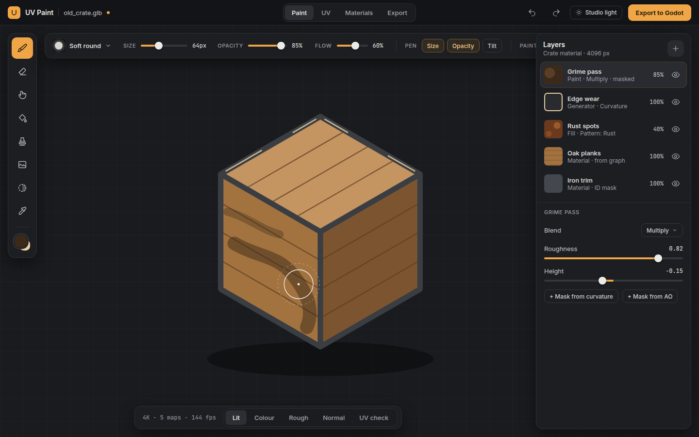
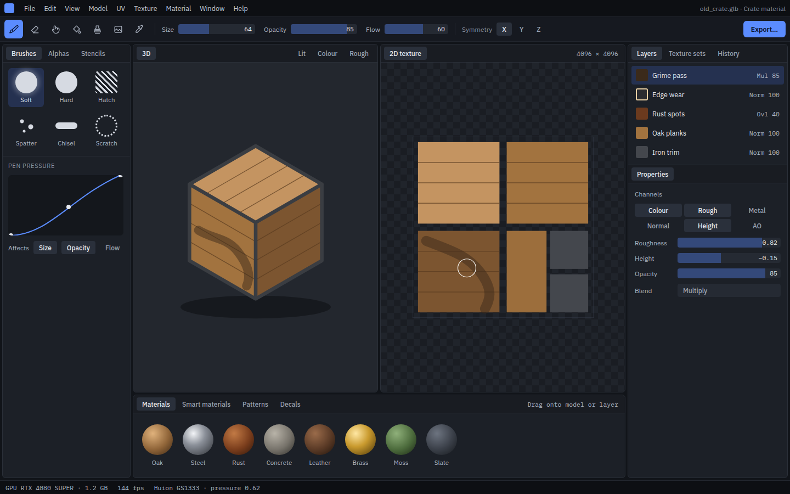
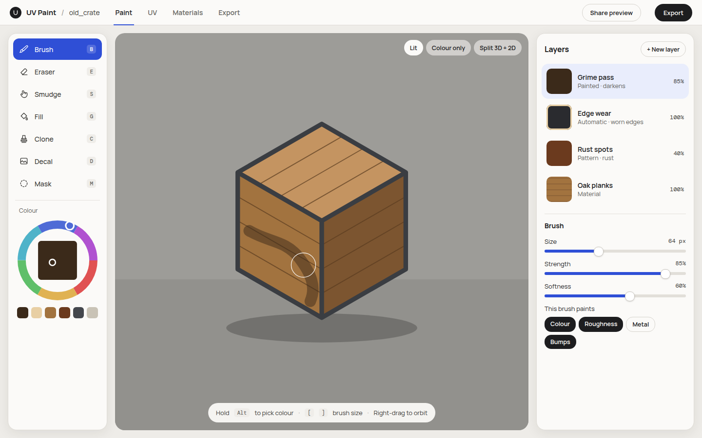
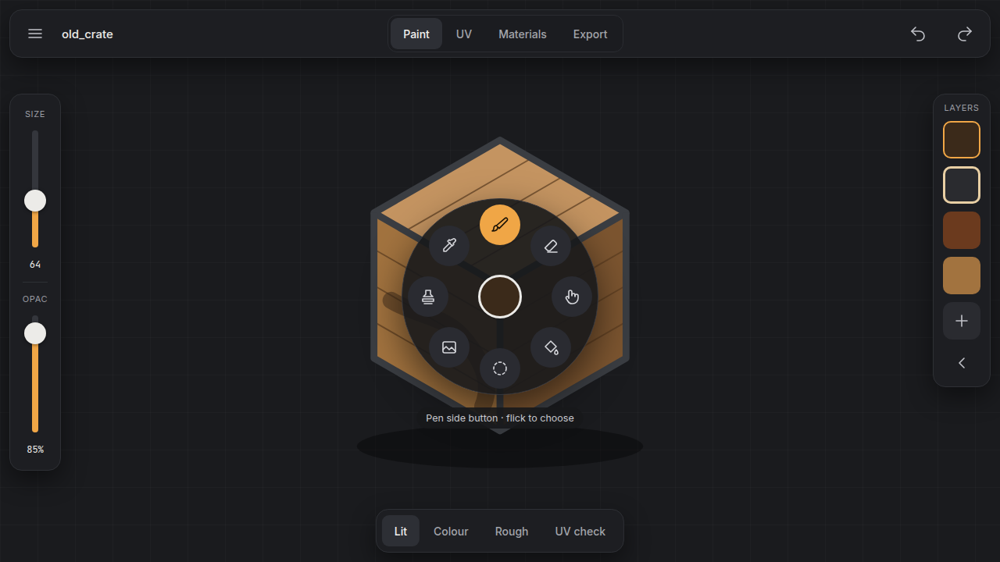
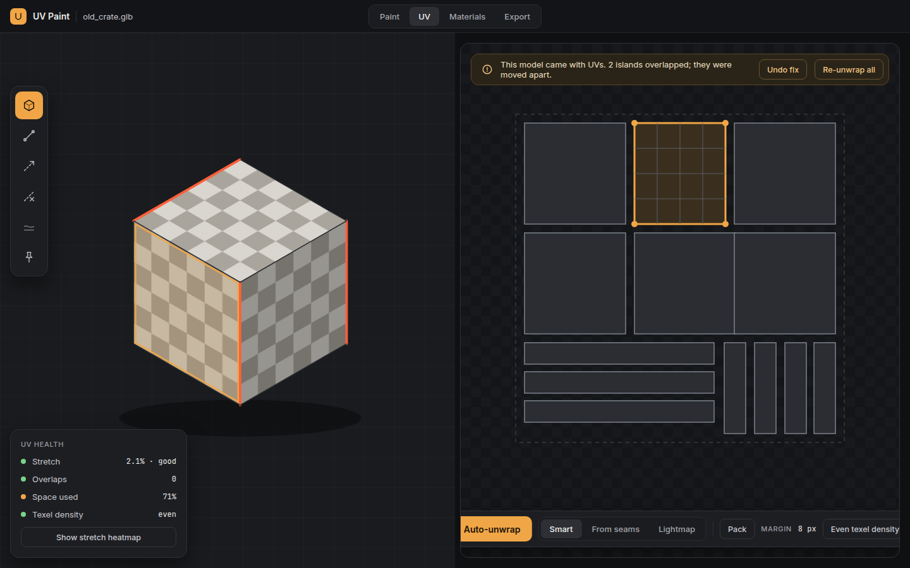
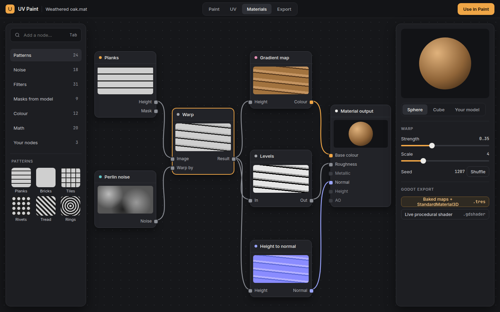

# Mood boards

Made 2026-11-20 on a claude.ai design canvas: https://claude.ai/artifact/E8GbWYxUjGiBd64yMBB9PH
(sources in `moodboards/`; the screenshots below were rendered from them). The boards predate
the name, so their top bars say "UV Paint".

**Chosen: Direction A, Graphite.**

## Three directions for the Paint workspace

### A · Graphite: floating panels, viewport first

Dark neutral ground, the 3D view fills the screen, tools and layers float as rounded
panels, one amber accent. Panels can collapse to edge strips, so it scales down to small
pen displays.

### B · Slate: docked pro workspace

Fixed docked panels, 3D and 2D views side by side, a materials shelf along the bottom.
Closest to Substance. Dense, and hard to fit on a 13" screen.

### C · Porcelain: light, airy

Light theme, tools labelled with their shortcut keys, a colour wheel in the sidebar,
shortcut hints over the viewport. Friendly, but a light UI is unusual for colour work.

## Direction A carried through

### On a 13" pen display (Kamvas 13 at 150 %, 1280×720)

Vertical size and opacity sliders on the left edge, layers collapsed to a thumbnail strip,
and a radial tool menu that opens around the pen on the side button.

### UV workspace

3D view with seams in orange and the selected face outlined; 2D islands on a checker;
a banner when imported UVs were fixed automatically; a UV health card; one-click
Auto-unwrap (Smart / From seams / Lightmap), Pack, margin and even texel density.

### Material graph

Node library with search (Tab), typed wires (colour, greyscale, normal), live node
previews, a material preview on sphere/cube/your model, and Godot export as baked maps +
StandardMaterial3D or a live procedural `.gdshader`.

