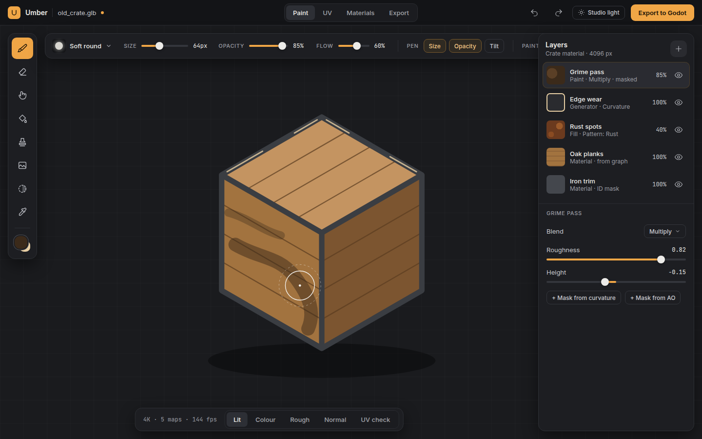
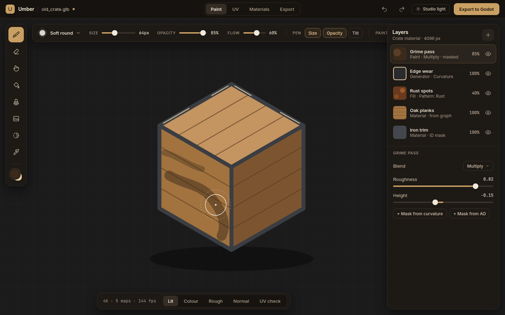
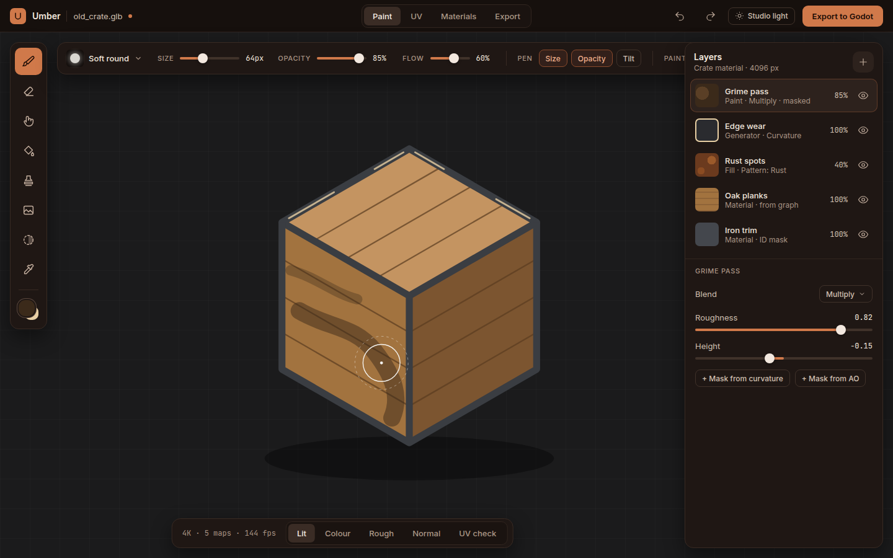
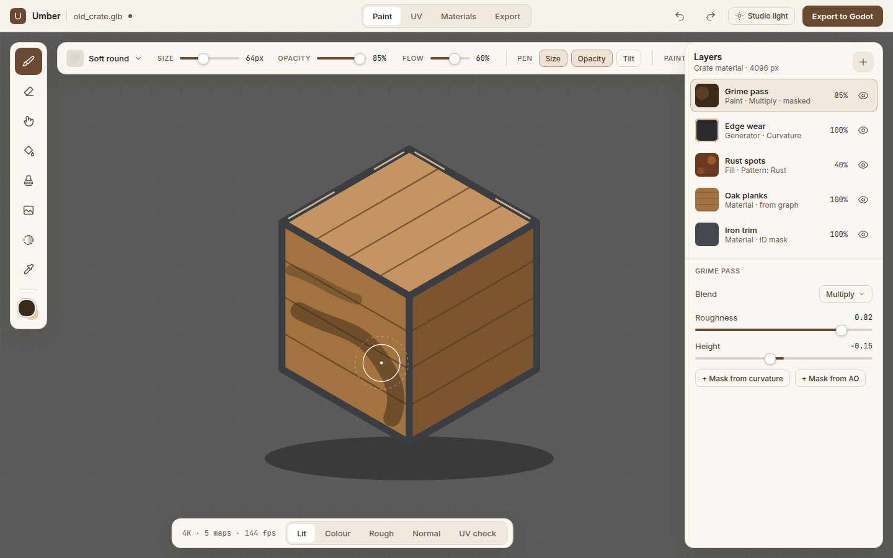

# Theme review: aligning Graphite with the name Umber

Asked 2026-11-20: can the colour scheme fit "Umber" better while staying luxurious, classy,
clean and easy to use? The four options are rendered on the same Paint screen (from the
direction A mood board), so only the colours change. The decision is on the board as a
look hand-off.

## What's wrong with the current theme

- **Cool neutrals against a warm name.** The greys lean blue (#0f1012, #1d1e22), which reads
  as a developer tool rather than an artist's studio.
- **The accent is loud.** #f0a646 is a saturated safety orange. On large fills (the Export
  button, the active tool) it's the brightest thing on screen, and it competes with the
  artwork. Luxury palettes use lower chroma and restraint.
- **Text is cool white**, which feels clinical next to warm artwork.

## What stays the same in every option

- **The viewport stays neutral grey.** A tinted surround shifts how colours on the model are
  judged, so warmth lives in the chrome only. (Mood board grids are illustrative; the real
  viewport colour is #1b1b1c in the dark options.)
- **Contrast stays at WCAG AA or better** for all text, including the 11 px caps labels
  (≥ 4.5:1), and for text on the accent.
- The accent stays rare: the active tool, the primary action, selection and slider fills.

## The options

### 1 · Current: Graphite and amber

### 2 · Umber and brass (recommended)

Warm charcoal ground (#110f0d, panels #1d1915), ivory text (#f1e9dc), and a burnished brass
accent (#c9a063). It keeps everything Graphite does well (calm, dark, uncluttered) and adds
the warmth of the name. Brass reads as a material, like fittings on a fine case, so it feels
expensive without shouting. The lower chroma also competes less with the artwork.

### 3 · Burnt umber and terracotta

Espresso ground (#120d0b), cream text, a burnt-sienna accent (#d0794a). The most "pigment"
of the options and the most literal to the name, but it's warmer overall and the accent
sits close to skin and wood tones, so it can blur into the artwork on character models.

### 4 · Parchment (light)

Warm paper ground (#ece6dd, panels #faf7f2), umber-brown ink, an umber accent (#6b4a33)
and a neutral mid-grey viewport. Like fine stationery: elegant, and good in bright rooms.
Better offered later as a second theme than as the default for long painting sessions.

## Recommendation

Make **Umber and brass** the default, and keep **Parchment** as a light-mode option for
later. All colours live in `src/theme.rs`, so switching is a small change once the user
picks. Script that made the variants: `moodboards/theme-variants.py`.
